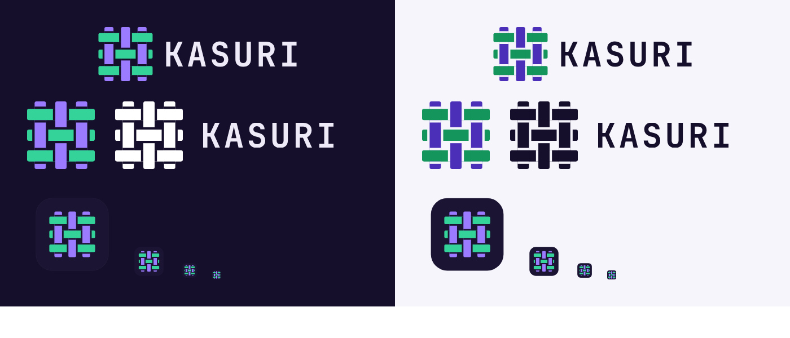

# Kasuri brand kit

**Kasuri** (絣, ka-SOO-ree) is a Japanese weaving technique: the threads are dyed
before weaving, and the pattern only appears once they are woven together. That
is how the app works: each agent prepares its own thread in its own worktree, and
the result only comes together when you review and merge it.



## Files

| Folder | File | Use |
| --- | --- | --- |
| `logo/` | `kasuri-lockup-on-dark.svg`, `kasuri-lockup-on-light.svg` | Mark + wordmark, side by side. The default logo. |
| `logo/` | `kasuri-mark-on-dark.svg`, `kasuri-mark-on-light.svg` | The woven mark alone. |
| `logo/` | `kasuri-wordmark-on-dark.svg`, `kasuri-wordmark-on-light.svg` | `KASURI` alone, as outlines (no font needed). |
| `logo/` | `kasuri-mark-mono-white.svg`, `kasuri-mark-mono-black.svg` | One-color mark for places that allow one color. |
| `icon/` | `kasuri-app-icon.svg`, `kasuri-app-icon-{1024,512,256,128}.png` | App icon (macOS tile). |
| `icon/` | `kasuri-app-icon-small.svg`, `kasuri-app-icon-{64,32,16}.png` | App icon for small sizes: wider gaps so the weave still reads. |
| `icon/` | `kasuri.icns` | macOS icon for the `.app` bundle (replaces `desktop/macos/icon.icns`). |
| `icon/` | `favicon.svg`, `favicon.ico` | Browser tab icon for the Web UI. |
| `tokens/` | `kasuri.css` | Brand colors as CSS variables, plus a drop-in `kasuri` palette for `web/src/styles/tokens.css`. |
| `tokens/` | `kasuri.json` | The same colors as data. |
| `source/` | `build_brand.py`, `render_brand.py` | Scripts that generate everything above. |

"On dark" files use the bright thread colors; "on light" files use the deep ones.
Never put a bright mark on a light background: emerald and violet are too faint there.

## The mark

- A 3×3 weave. Horizontal threads are **emerald**, vertical threads are **violet**.
- Over and under alternate like a checkerboard: the top-left crossing has the
  horizontal thread on top. Where one thread passes over, the one underneath is
  cut by a small gap on both sides.
- The gaps are real cut-outs, so the mark works on any background.
- Below 64 px use the small version (wider gaps). The favicon is already drawn that way.
- **Clear space:** leave at least one thread's width (1/6 of the mark's width) free
  on every side.
- **Minimum size:** 16 px for the icon; 20 px tall for the lockup.

Don't: swap the thread colors, change the over/under pattern, add shadows,
gradients or outlines, stretch it, or set the wordmark in another typeface.

## Colors

Emerald is for **actions** (primary buttons, "needs you", success). Violet is for
**navigation** (the active page, selection, focus ring, links).

### Dark mode

| Role | Hex |
| --- | --- |
| Background (midnight violet) | `#160F2B` |
| Chrome / sidebar | `#120C24` |
| Surface · surface 2 · surface 3 | `#1B1433` · `#221A3D` · `#2A2148` |
| Lines | `#2F2650` |
| Text · secondary · muted · faint | `#EEEAF8` · `#C9C2DD` · `#A79FC2` · `#6E6491` |
| Emerald (thread, primary button with `#160F2B` text) | `#34D399` |
| Violet (thread, active page, focus) | `#9B7BFF` |

### Light mode

| Role | Hex |
| --- | --- |
| Background · paper | `#FFFFFF` · `#F7F5FC` |
| Chrome / sidebar | `#EFECF6` |
| Lines | `#E4DFF0` |
| Text · secondary · muted · faint | `#160F2B` · `#3B3355` · `#625A78` · `#9A93AE` |
| Deep emerald (thread) | `#14955C` |
| Action green (primary button with white text) | `#0F7A4B` |
| Deep violet (thread, active page, focus) | `#4B2FB8` |

## Type

- **Wordmark:** JetBrains Mono Bold, uppercase, letter-spacing 0.08em. The SVGs
  already contain it as outlines.
- **Interface text:** Inter. **Code:** JetBrains Mono. (Both are already the Web UI's fonts.)
- **Kanji:** 絣 in Zen Kaku Gothic New, when it appears next to the name.

## Regenerating

```sh
pip install fonttools pillow playwright
python3 source/build_brand.py path/to/JetBrainsMono-Bold.ttf brand
python3 source/render_brand.py brand brand/kasuri-brand-preview.png
```

JetBrains Mono comes from https://github.com/JetBrains/JetBrainsMono (OFL).
